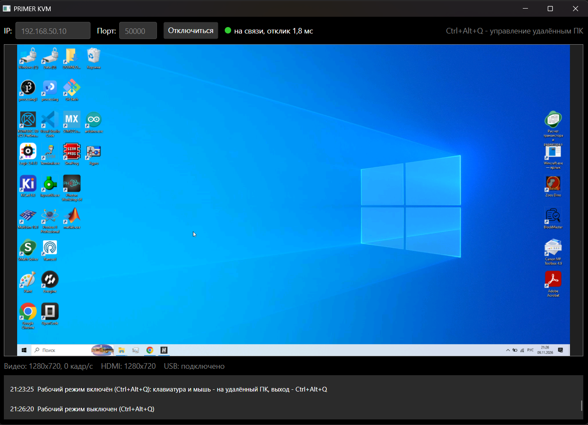
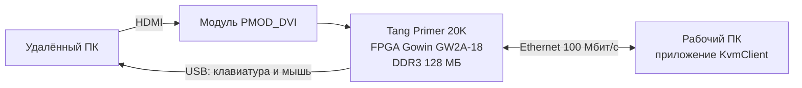
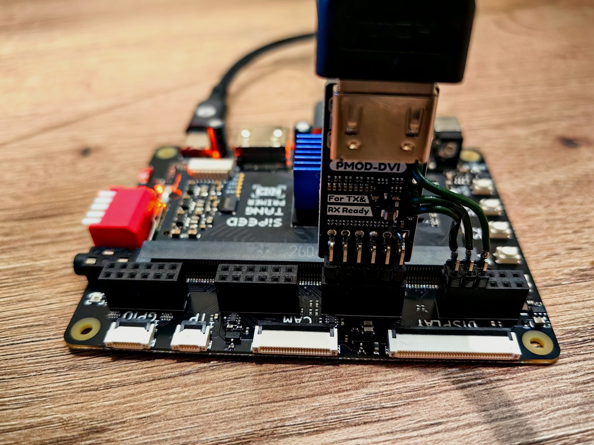
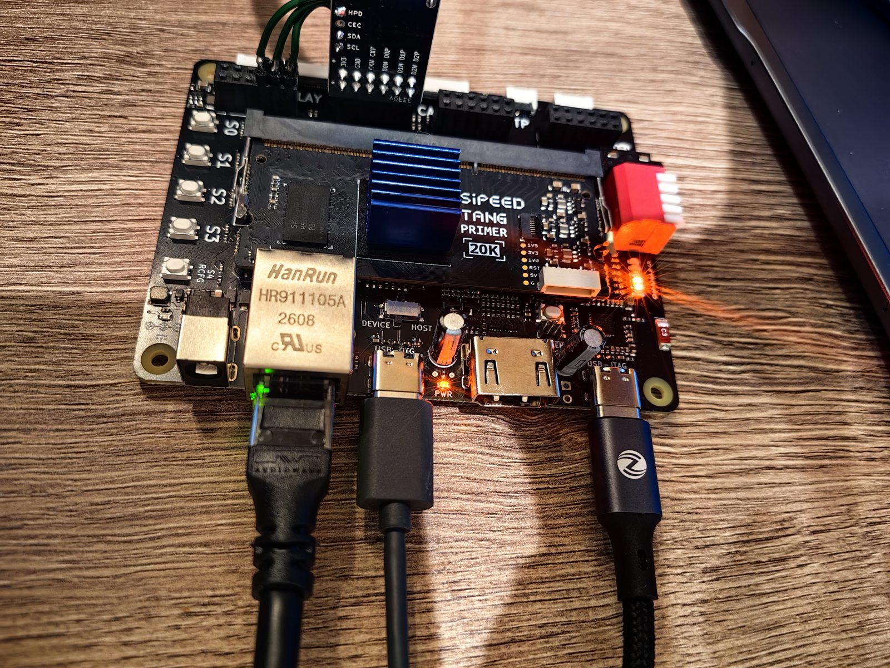

# PRIMER_KVM

**KVM over IP на FPGA.** Плата Sipeed Tang Primer 20K принимает изображение удалённого компьютера по HDMI и
передаёт его по Ethernet на рабочий ПК. Клавиатура и мышь рабочего ПК управляют удалённым компьютером: плата
подключена к нему по USB и для него выглядит как обычные клавиатура и мышь.



## Возможности

- Вход HDMI 1280×720@60. По сети передаются только изменившиеся участки экрана, поэтому обычной работе с
  рабочим столом хватает Ethernet 100 Мбит/с.
- Полноэкранный режим управления: **Ctrl+Alt+Q** — и клавиатура с мышью работают с удалённым ПК.
- Клавиатура работает и в BIOS; мышь — с абсолютными координатами (курсор там же, где на изображении), пять
  кнопок, колесо и горизонтальная прокрутка.
- На удалённый ПК ничего устанавливать не нужно: для него плата — монитор, клавиатура и мышь.
- Без связи дольше секунды приложение показывает «Нет связи»; при отключении приложения плата отпускает все
  нажатые клавиши.

## Как это устроено



- **FPGA** принимает HDMI, складывает кадры в память DDR3, считает контрольную сумму каждого участка 32×16
  пикселей и отправляет по сети только изменившиеся участки.
- **Процессор внутри FPGA** (PicoRV32) ведёт сетевой обмен с приложением и формирует USB-отчёты клавиатуры и мыши.
- **Приложение** на рабочем ПК собирает изображение из участков, показывает его и передаёт нажатия клавиш и
  движения мыши.

## Что понадобится

| Оборудование | Примечание |
|---|---|
| Sipeed Tang Primer 20K + Dock | плата с FPGA GW2A-LV18PG256C8/I7 |
| Модуль Sipeed PMOD_DVI | вход HDMI |
| 3 провода «мама–мама» | от модуля PMOD_DVI к разъёму J5 |
| Кабель Ethernet | прямо к рабочему ПК (или через USB-адаптер Ethernet) |
| Кабель HDMI | от удалённого ПК |
| 2 кабеля USB-C | к удалённому ПК и к рабочему ПК (прошивка и питание) |

| Программы (Windows) | Для чего |
|---|---|
| [Gowin EDA Education](https://www.gowinsemi.com/en/support/download_eda/) V1.9.11.03 | синтез FPGA и прошивка платы |
| [VS Code](https://code.visualstudio.com/), [CMake](https://cmake.org/download/) ≥ 3.21, [Ninja](https://github.com/ninja-build/ninja/releases) | сборка платы |
| [.NET 10 SDK](https://dotnet.microsoft.com/download/dotnet/10.0) (или Visual Studio 2026) | приложение |

CMake, Ninja и .NET можно поставить одной командой:
`winget install Kitware.CMake Ninja-build.Ninja Microsoft.DotNet.SDK.10`.
Компилятор RISC-V скачивается сам при первой настройке.

## Подключение



1. **Модуль PMOD_DVI** — в разъём **J6** платы. Выводы модуля **SCL, SDA, HPD** — проводами к разъёму **J5**
   (выводы FPGA A11, N6 и N9 соответственно, см. `board/fpga/constraints/kvm.cst`). По этим проводам удалённый ПК
   узнаёт поддерживаемое разрешение.
2. **HDMI** от удалённого ПК — в модуль PMOD_DVI.



3. **Ethernet** — к рабочему ПК.
4. **USB-C рядом с переключателем DEVICE/HOST** — к удалённому ПК. Переключатель — в положение **DEVICE**.
5. **Второй USB-C** (встроенный отладчик) — к рабочему ПК: питание, прошивка платы и журнал работы (COM-порт).

> Линия питания USB-разъёма, который идёт к удалённому ПК, соединена с питанием платы. Если плата питается от
> отдельного источника, используйте для удалённого ПК кабель без линии питания.

## Быстрый старт

### 1. Прошить плату

1. Открыть папку **`board`** в VS Code.
2. **Терминал → Запустить задачу → «Настройка: инструменты»** — один раз. Скачивает компилятор, проверяет, что
   всё установлено. Если Gowin установлен не в `C:\Gowin\…`, путь поправить в `board/config/project.cfg`.
3. **Терминал → Запустить задачу → «Сборка и прошивка платы»** — несколько минут. В конце: `[OK] flash записана`.

После прошивки на плате мигает светодиод LED0, а удалённый ПК видит новый монитор «PRIMER KVM», клавиатуру и мышь.

### 2. Настроить сеть рабочего ПК

Плате нужен адрес в своей подсети: плата — `192.168.50.10`, рабочий ПК — `192.168.50.1`.

- Автоматически: задача **«Настройка: сеть ПК»** (попросит права администратора). Сетевой адаптер ищется по
  описанию из `NET_PC_ADAPTER` в `board/config/project.cfg`.
- Или вручную: свойства сетевого адаптера → IPv4 → адрес `192.168.50.1`, маска `255.255.255.0`.

### 3. Запустить приложение

- Открыть `host-app/KvmClient.slnx` в Visual Studio и запустить,
- или открыть папку `host-app` в VS Code → задача **«Запуск»**,
- или в командной строке: `dotnet run --project host-app/KvmClient -c Release`.

В приложении нажать **«Подключиться»** — появится изображение удалённого ПК.

### 4. Управлять удалённым ПК

| Клавиши | Действие |
|---|---|
| **Ctrl+Alt+Q** | войти в режим управления (окно на весь экран) и выйти из него |
| **Ctrl+Alt+End** | отправить удалённому ПК Ctrl+Alt+Del |

В режиме управления все клавиши, включая Win и Alt+Tab, передаются удалённому ПК. Переключение на другое окно
рабочего ПК выключает режим.

## Светодиоды платы

| LED | Горит, когда |
|---|---|
| 0 | мигает — плата работает |
| 1 | принимается сигнал HDMI |
| 2 | память DDR3 исправна |
| 3 | передаётся изображение |
| 4 | приходят пакеты Ethernet |
| 5 | приложение подключено |

Журнал работы платы — COM-порт встроенного отладчика, 115200 бод:

```
PRIMER_KVM, прошивка Nov  9 2026 21:00:00
Сеть: IP 192.168.50.10, UDP 50000, MAC 02:4B:56:4D:00:01
DDR3: 128 МБ, проверка пройдена
HDMI: EDID 1280x720, 74250 кГц
Сеть: линк есть
HDMI: сигнал 1280x720, захват
USB: подключено к удалённому ПК (High Speed)
Приложение: подключено
```

## Если не работает

| Признак | Что проверить |
|---|---|
| «Нет связи» в приложении | кабель Ethernet, адрес ПК `192.168.50.1`; при включённом VPN — добавить сеть 192.168.50.0/24 в исключения |
| Тестовая картинка вместо рабочего стола | кабель HDMI, провода SCL/SDA/HPD; разрешение удалённого ПК — 1280×720 |
| Клавиатура и мышь не работают | USB-кабель к удалённому ПК в разъёме рядом с DEVICE/HOST, переключатель — DEVICE |
| Сборка остановилась с ошибкой | путь к Gowin в `board/config/project.cfg`; задача «Настройка: инструменты» |

## Структура

```
board/       FPGA (SystemVerilog), прошивка процессора (C), скрипты сборки - открывать в VS Code
  config/    project.cfg - все настройки: пути, частоты, разрешение, сеть
  docs/      DESIGN.md - устройство, протокол, регистры, выводы
host-app/    приложение для рабочего ПК (C#, Avalonia)
pic/         фотографии
```

Подробное описание устройства — [`board/docs/DESIGN.md`](board/docs/DESIGN.md), приложения —
[`host-app/README.md`](host-app/README.md).

## Ограничения

- Вход HDMI — только 1280×720 (другой режим задаётся в `project.cfg` и требует пересборки).
- Звука нет (удалённый ПК видит DVI-монитор).
- Приложение — только для Windows.

## Сторонние компоненты и лицензия

- `board/firmware/sdk/` — файлы SDK Gowin_PicoRV32 (GowinSemiconductor) с правками частоты и режима загрузки.
- IP-ядра Gowin (PicoRV32, DDR3, Ethernet MAC, DVI RX, USB 2.0 Device) в репозиторий не входят: при сборке они
  берутся из установленной Gowin EDA. Утилиты make_hex и merge_bit (`board/tools`) ставятся задачей «Настройка»
  из архива SDK Gowin_PicoRV32 V1.7 (путь — `PICORV32_SDK_ZIP` в `project.cfg`).
- USB VID/PID 1209:0001 — тестовый идентификатор pid.codes.

Собственный код проекта распространяется по лицензии MIT — см. [LICENSE](LICENSE).
